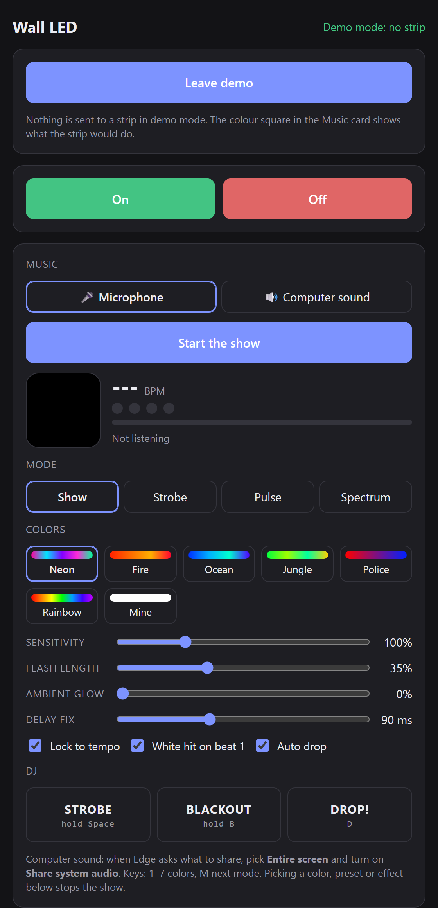

# Wall LED

Control a Bluetooth LED strip from your PC or Android phone, and turn it into a music light show.

Made for the cheap **LEDDMX** controllers (they advertise as `LEDDMX-00-xxxx` / `LEDDMX-03-xxxx`) that normally come with the *LED LAMP* phone app. An open-source **LED LAMP app alternative** that runs in the browser with **Web Bluetooth**.

**Try it:** open **[https://heditrigui.github.io/wall-led/](https://heditrigui.github.io/wall-led/)** in Chrome or Edge. No strip? Try the **[demo](https://heditrigui.github.io/wall-led/led-control.html?demo)** to click around the whole interface.

<p align="center"></p>

- **On / off, color, brightness, presets**
- **Several strips at once**: connect as many LEDDMX controllers as you like; every command goes to all of them in sync, and each strip has its own on / off
- **210 built-in effects** of the controller
- **Scenes**: save the current color, brightness and effect under a name and bring it back with one tap
- **Schedules**: e.g. "Sunset at 19:00, off at 23:30" on chosen days, and a **wake-up fade** that brightens over N minutes to reach full brightness at the set time
- **Music light show**: listens to the microphone (or, on the PC, to the computer's own sound) and drives the strip in real time
  - **Show** mode flashes on every beat, cycles through a color theme, hits white on beat 1, breathes during breakdowns and strobes on the drop
  - **Strobe**, **Pulse** and **Spectrum** modes
  - Color themes: Neon, Fire, Ocean, Jungle, Police, Rainbow, or your own color
  - Tempo lock: [BeatSense](https://github.com/heditrigui/beatsense)'s tempo detector finds the BPM and the beat phase, and each flash fires slightly early to cancel out Bluetooth delay
  - DJ controls: hold Space to strobe, hold B for blackout, press D for a drop, 1–7 for themes, M for the next mode
- **Screen sync** (PC): the strip follows the colors on your screen, like an ambient light behind a TV or monitor

No server, no account, no install on the PC: it's one HTML file.

## Use it on a PC (Windows, macOS, Linux, ChromeOS)

1. Open **[https://heditrigui.github.io/wall-led/](https://heditrigui.github.io/wall-led/)** in **Chrome** or **Edge** (they support Web Bluetooth). You can also download [`led-control.html`](led-control.html) and open it from disk.
2. Close the LED LAMP app on your phone first. The controller accepts only one connection at a time.
3. Click **Connect** and pick your `LEDDMX-…` strip. To add more strips, click **Add a strip** and pick the next one.

To drive the show from music playing on the PC, choose **Computer sound**, then pick *Entire screen* and turn on *Share system audio* when the browser asks.

For **screen sync**, click **Sync with the screen** and pick the screen or window to follow. *Vivid* takes the color from the most colorful parts of the picture; *Average* uses the whole picture. It keeps running while the tab is in the background.

Scenes and schedules are saved in the browser. In the browser, schedules run while the page is open (a background tab is fine) and a strip is connected.

## Use it on Android

Download the APK from the [latest release](../../releases/latest), open it on your phone and allow installing from your browser or file manager. It needs Android 12 or newer.

The app shows the same page, with Bluetooth handled natively, because Android's WebView has no Web Bluetooth. On the phone the show listens through the microphone, and the screen stays on while it runs. Tap **Add a strip** again to connect more strips; each tap connects the next strip it finds.

Schedules also run while the app is closed: an alarm starts a short background service that connects to the strips the phone has used before and sends the scene (or runs the wake-up fade), then disconnects. Keep the strips in range and the LED LAMP app closed. Screen sync is PC only.

### Build it yourself

You need JDK 17 and the Android SDK (platform 35).

```bash
cd android
./gradlew assembleRelease
```

The APK lands in `android/app/build/outputs/apk/release/`. The build copies `../led-control.html` into the app automatically, so both versions always match.

## Protocol

The controller exposes GATT service `ffe0` with characteristic `ffe1` (write without response). Every command is 9 bytes:

| Command | Bytes |
|---|---|
| Power on | `7B 00 04 01 00 00 FF 00 BF` |
| Power off | `7B 00 04 00 00 00 FF 00 BF` |
| Color | `7B FF 07 RR GG BB 00 FF BF` |
| Brightness (pct 0–100) | `7B FF 01 (pct*32/100) pct 00 FF FF BF` |
| Built-in effect (1–210) | `7B FF 03 idx FF FF FF FF BF` |

Verified on an `LEDDMX-03` controller. The on/off frames differ from the ones documented elsewhere for these controllers (`7B FF 04 03/02 …`), which did nothing on this unit.

Each strip needs its own Bluetooth connection, so commands to several strips go out side by side, within a few milliseconds of each other.

Thanks to [JENSLINJEMZ/ScreenSYNC](https://github.com/JENSLINJEMZ/ScreenSYNC) and [user154lt/LEDDMX-00](https://github.com/user154lt/LEDDMX-00) for documenting the color, brightness and effect commands.

## Project layout

```
led-control.html          the whole PC app (UI, Bluetooth, music show, screen sync, schedules)
tests/logic.test.js       tests for the page's beat clock, screen colors and schedule times
android/                  Android wrapper
  app/src/main/java/com/wallled/app/
    MainActivity.kt       WebView host, permissions
    LedBle.kt             native Bluetooth links (one per strip), exposed to the page as window.AndroidBle
    Schedules.kt          alarms for the page's schedules
    ScheduleService.kt    runs a due schedule in the background
```

Run the tests with Node:

```bash
node tests/logic.test.js
```

The tempo detector in the page is copied from [BeatSense](https://github.com/heditrigui/beatsense) (`docs/tempo.js`, MIT).

## License

[MIT](LICENSE). Not affiliated with the makers of the LED LAMP app or the controllers.
